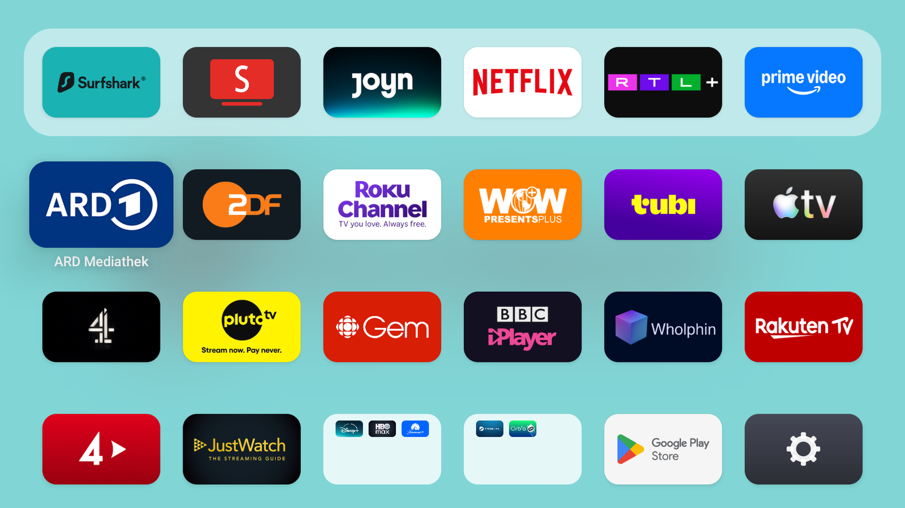
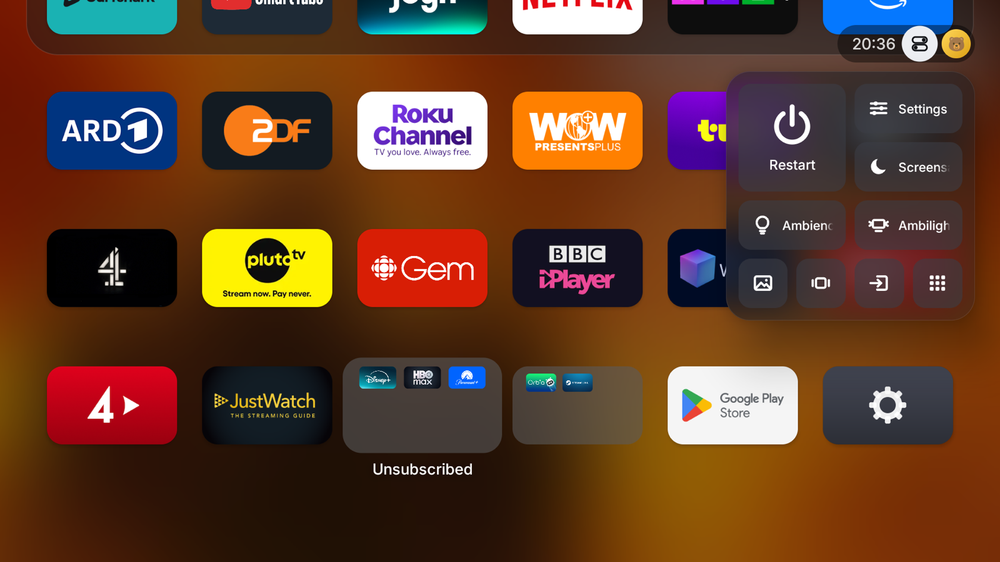
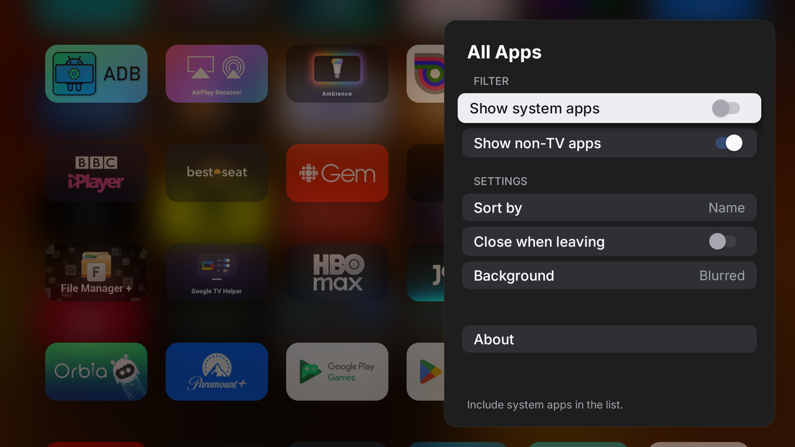
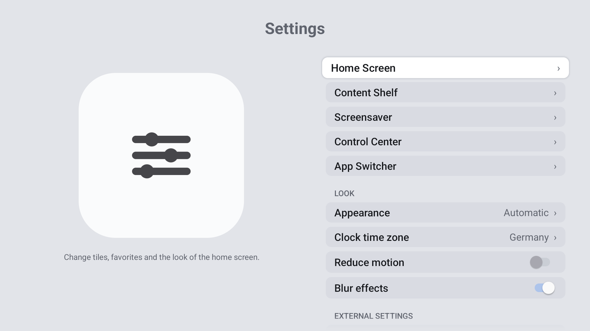

<p align="center">
  
</p>

<h3 align="center">A tvOS-inspired launcher for Google TV</h3>

<p align="center">
  Calm, big and focused: your apps in a clean grid, a top shelf with what to watch next,
  and a control center one double-press away.
</p>

---

<p align="center">
  
</p>

## Highlights

| | |
|---|---|
|  | **Top shelf.** Focus an app in the top row and the screen fills with its previews. You can jump straight into a show or film. |
|  | **Control center.** Double-press HOME to open it. It has profiles, picture and sound, inputs, Ambilight and Hue Sync, the screensaver and restart, all over a frosted-glass panel. |
|  | **Folders and dock.** Group apps into folders, pin favourites to the top row and hide what you never use. |
|  | **App switcher.** Recent apps appear as a card stack. You can jump back or close an app. |
|  | **All apps.** Every installed app in one list, including the ones hidden from the home screen. |
|  | **Screensaver.** It shows aerial videos or online photos. The clock hops around the screen, so nothing stays static on an OLED. |
|  | **Settings.** Light and dark mode, six fonts, clock and time zone, profiles, layout backup and restore. |

## Requirements

Best Seat was built for one TV, a **Philips OLED with Google TV (Android 14, 1080p UI)**. Most of it works on any Google TV or Android TV device with **Android 8.0 (API 26) or newer**. Some parts need extra setup or only work on Philips TVs.

### Works everywhere (with some setup)

| Feature | What it needs |
|---|---|
| Being the home screen | Set Best Seat as the default launcher. On Google TV this usually means disabling the stock launcher via adb: `pm disable-user --user 0 com.google.android.apps.tv.launcherx` |
| App switcher, layout backup, closing apps | **Network debugging** on port 5555. Best Seat connects to its own TV via adb (`127.0.0.1:5555`) and must be allowed once on the TV |
| Recent apps | **Usage access** for Best Seat (Settings → Apps → Special app access) |
| Top shelf previews | Apps that publish preview programs to the TV provider (most streaming apps do) |
| Screensaver videos and photos | Internet access |
| Layout | Tuned for a 1920×1080 UI. Other display densities are untested |

### Philips only

| Feature | Why |
|---|---|
| **Restart** in the control center | Opens the Philips restart dialog (`org.droidtv.tvsystemui`) |
| **Picture** in the control center | Uses the vendor picture settings intent (`android.settings.PICTURE_ACTIVITY`) |
| **Live TV / inputs** | Uses the Philips TV app (`org.droidtv.playtv`) for channels and HDMI inputs |
| **"USB storage missing" notice** | Closes a Philips settings screen that appears after standby when apps live on a USB stick |
| Hidden system apps | Philips, TP Vision and MediaTek system packages are filtered out of lists |

### Companion apps (optional, not in this repository)

Some control center tiles talk to small helper apps of mine. Without them the tiles simply do nothing or stay hidden:

- **Ambilight and Hue Sync**: a helper app that switches Ambilight and Philips Hue Sync
- **VPN**: a VPN status helper (Surfshark)
- **Remote buttons**: a key-remapping app (for example tvQuickActions) to open the control center or screensaver with a button

## Build

There is no Gradle. `build.sh` builds `build/launcher.apk` directly with the Android build tools (API 34, Java 8 target):

```bash
./build.sh
adb install -r --user 0 build/launcher.apk
```

`build.sh` creates a signing key (`debug.keystore`) on the first run. The key is not part of this repository. Keep it, because updates must be signed with the same key.

## Credits

Created by Börni (burni2001). Built with [Claude Code](https://claude.com/claude-code).
Features modelled on AT4K Launcher, design inspired by tvOS.
Bundled fonts Inter, Manrope, Plus Jakarta Sans, Outfit and Urbanist are licensed under the SIL Open Font License 1.1 (see `docs/fonts`).
