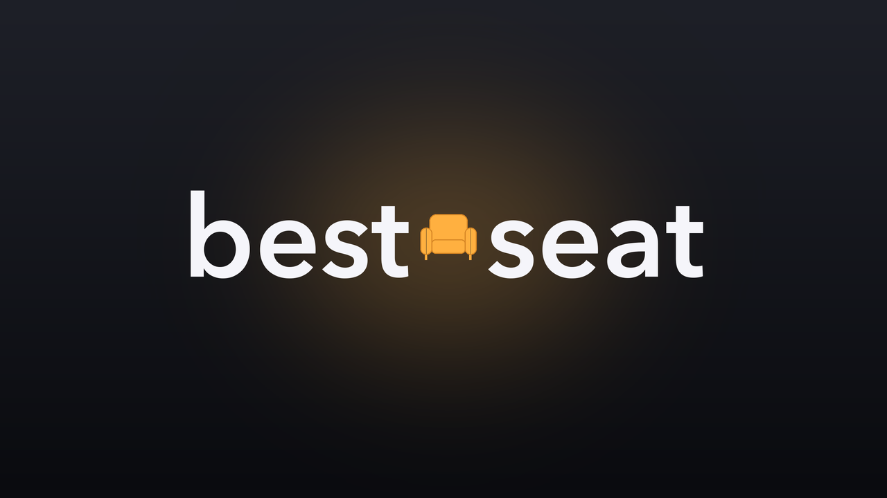
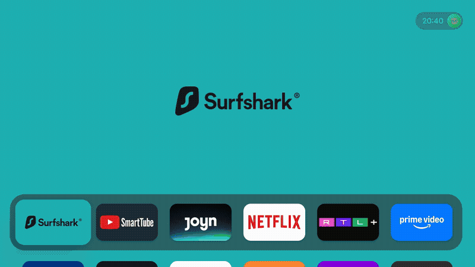
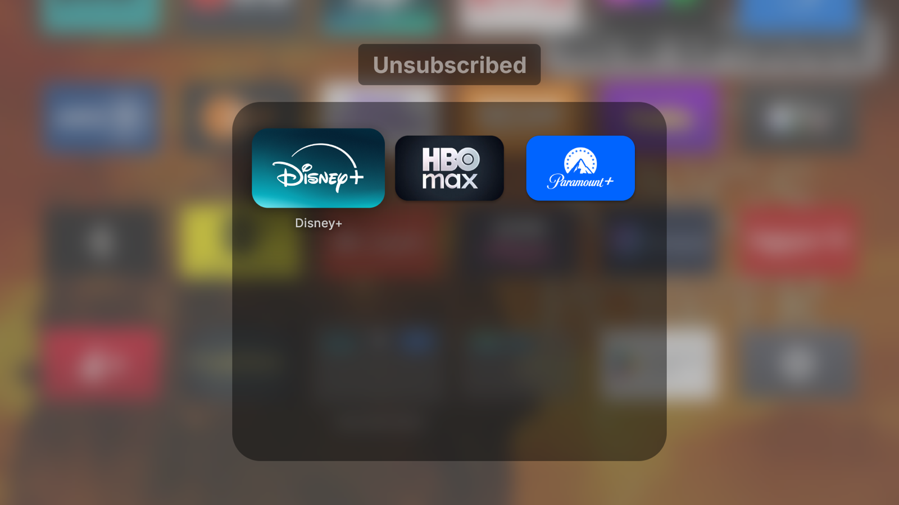
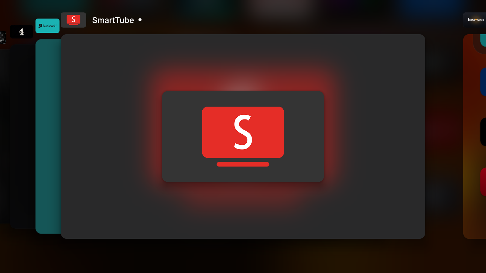
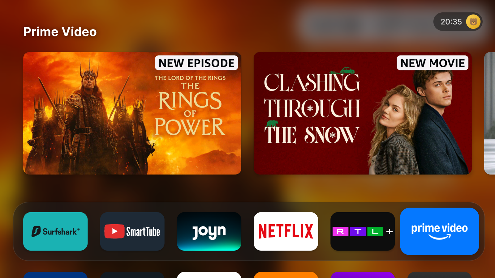
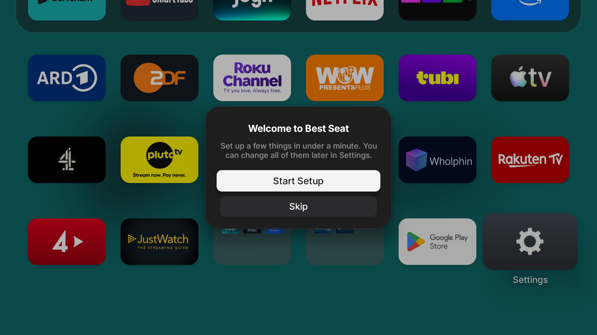

<p align="center">
  
</p>

<h3 align="center">A launcher for Google TV heavily inspired by tvOS</h3>

<p align="center">
  Calm, big and focused: your apps in a clean grid, a top shelf with what to watch next,
  and a control center one double-press away.
</p>

---

<p align="center">
  <a href="docs/demo.mp4"></a>
  <br><sub>Click for the full one-minute demo video.</sub>
</p>

## Highlights

| **Control center** | **Folders** | **App switcher** | **All apps overview**| **Settings** |
|---|---|---|---|---|
|  |  |  |  |  |

| **Content shelf** | **Home screen** | **Screensaver** | **Setup assistant** |
|---|---|---|---|
|  |  |  |  |

## Features

### Home screen
- **Clean app grid** with a favorites row and a **Content Shelf** above it that shows what to watch next from apps that publish previews
- **Folders**: group apps, rename folders and sort apps inside them
- **Move, hide and restore** tiles with a long press on OK
- **Custom tile images**: type an image address on the TV, or scan a QR code and upload a picture from your phone
- **Grey placeholder tiles** for apps on a USB stick that is not plugged in, so the layout never jumps
- **Profiles** with their own layout and avatar

### All apps
- Every installed app in one grid, with the same context menu as the home screen
- A side menu (press right at the end of a row) for sorting and filters

### Control center
- Opens with a double press on Home (through a key-remapping app such as tvQuickActions)
- Tiles for Ambilight, picture settings, restart, VPN and more, freely sortable

### App switcher
- Recently used apps as **cards** or as a compact **bar**
- Force quit apps and hide apps from the list

### Screensaver
- **4K aerial videos**, online photos or a black screen with a clock
- The clock fades out and reappears somewhere else every few seconds, so nothing stays still on OLED panels
- Starts on the home screen **and in idle apps** (no input and nothing playing), before the TV dims the picture

### And also
- **VPN prompt**: choose apps that should only open with the VPN connected
- **Appearance**: dark, light or automatic (light during the day), five bundled fonts, reduced motion, optional blur
- **Backup and restore** of tiles, folders and settings to the TV's Downloads folder
- **Setup assistant** on first start: adb access, restore a backup, appearance and screensaver

## Requirements

Best Seat was built for our own TV, a **Philips Ambilight OLED with Google TV (Android 14, 1080p UI)**. Most of it should work on any Google TV or Android TV device with **Android 8.0 (API 26) or newer**. Some parts need extra setup or only work on Philips TVs with Ambilight.

### Works everywhere (with some setup)

| Feature | What it needs |
|---|---|
| Being the home screen | Set Best Seat as the default launcher. On Google TV this usually means disabling the stock launcher via adb: `pm disable-user --user 0 com.google.android.apps.tv.launcherx` |
| App switcher, backup, closing apps, VPN prompt, screensaver in idle apps | **Network debugging** on port 5555. Best Seat connects to its own TV via adb (`127.0.0.1:5555`) and must be allowed once on the TV |
| Recent apps | **Usage access** for Best Seat (Settings → Apps → Special app access) |
| Top shelf previews | Apps that publish preview programs to the TV provider (most streaming apps do) |
| Screensaver videos and photos | Internet access |
| Layout | Tuned for a 1920×1080 UI. Other display densities are untested |

### Philips only

| Feature | Why |
|---|---|
| **Restart** in the control center | Opens the Philips restart dialog (`org.droidtv.tvsystemui`) |
| **Picture** in the control center | Uses the vendor picture settings intent (`android.settings.PICTURE_ACTIVITY`) |
| **Live TV / inputs** | Uses the Philips TV app (`org.droidtv.playtv`) for channels and HDMI inputs |
| **"USB storage missing" notice** | Closes a Philips settings screen that appears after standby when apps live on a USB stick |
| Hidden system apps | Philips, TP Vision and MediaTek system packages are filtered out of lists |

### Companion apps (optional, not in this repository)

Some control center tiles talk to small helper apps of mine. Without them the tiles simply do nothing or stay hidden:

- **Ambience**: a helper app that switches Ambilight and Philips Hue Sync
- **AirPlay receiver** and **Google TV Helper**: their settings are linked from Best Seat's settings when installed
- **VPN**: the VPN tile and the VPN prompt open the Surfshark app
- **Remote buttons**: a key-remapping app (for example tvQuickActions) to open the control center or screensaver with a button

## Build

There is no Gradle. `build.sh` builds `build/launcher.apk` directly with the Android build tools (API 34, Java 8 target):

```bash
./build.sh
adb install -r --user 0 build/launcher.apk
```

`build.sh` creates a signing key (`debug.keystore`) on the first run. The key is not part of this repository. Keep it, because updates must be signed with the same key.

## Credits

Created by Börni (burni2001). Built with [Claude Code](https://claude.com/claude-code).
Features modelled on AT4K Launcher, design inspired by tvOS.
Bundled fonts Inter, Manrope, Plus Jakarta Sans, Outfit and Urbanist are licensed under the SIL Open Font License 1.1 (see `docs/fonts`).
